# Master Entity Relationship Diagram (ERD) & Kamus Data - GAIN NiagaKoin v4.0.0

Dokumen ini mendefinisikan arsitektur basis data relasional **PostgreSQL 16** (mencakup 24 migrasi skema resmi) serta model pembacaan reaktif (*reactive read-model*) **Cloud Firestore**. 

PostgreSQL berfungsi sebagai **Single Source of Truth (SSOT)** transaksi finansial berstandar ACID, sementara Cloud Firestore berfungsi sebagai **Client Real-Time Mirror** untuk menyajikan data latensi-rendah ke antarmuka aplikasi.

---

## 1. Entity Relationship Diagram (Mermaid Format)

```mermaid
erDiagram
    %% =========================================================
    %% MODUL IDENTITAS & AUTENTIKASI (ARSITEKTUR 25)
    %% =========================================================
    USERS ||--o{ AUTH_SESSION_ELEVATIONS : "memiliki sesi"
    USERS ||--o{ AUTH_VERIFICATION_CHALLENGES : "memiliki tantangan"
    USERS ||--o{ SECURITY_CREDENTIALS : "memiliki kredensial 2FA"
    USERS ||--o{ EXCHANGE_ACCOUNTS : "menghubungkan akun"
    USERS ||--o{ EXCHANGE_CREDENTIALS : "memiliki kunci API"
    USERS ||--o{ LICENSES : "memiliki lisensi"
    USERS ||--o{ BOTS : "memiliki bot"
    USERS ||--o{ ORDERS : "mengirim order"
    USERS ||--o{ WALLET_ACCOUNTS : "memiliki akun saldo"
    USERS ||--o{ WALLET_LEDGER : "memiliki mutasi"
    USERS ||--o{ DEPOSITS : "menerima deposit"
    USERS ||--o{ WITHDRAWALS : "mengajukan penarikan"
    USERS ||--o{ WALLET_DEPOSIT_ADDRESSES : "memiliki alamat setoran"
    USERS ||--o{ VOUCHER_REDEMPTIONS : "menukarkan voucher"

    %% =========================================================
    %% MODUL EXCHANGE & KREDENSIAL
    %% =========================================================
    EXCHANGE_ACCOUNTS ||--o{ BOTS : "digunakan oleh"
    EXCHANGE_CREDENTIALS ||--o{ EXCHANGE_CREDENTIAL_HISTORY : "memiliki riwayat audit"

    %% =========================================================
    %% MODUL BOT TRADING & STRATEGI
    %% =========================================================
    BOTS ||--|| BOT_STRATEGY_CONFIGS : "dikonfigurasi oleh"
    BOTS ||--o{ STRATEGY_LAYERS : "memiliki tingkatan layer"
    BOTS ||--o{ POSITIONS : "memiliki posisi akumulasi"
    BOTS ||--o{ ORDERS : "memicu pesanan"
    BOTS ||--o{ BOT_RUNTIME_SNAPSHOTS : "memiliki rekam jejak runtime"
    BOTS ||--o{ ORDER_EXECUTION_RESERVATIONS : "memiliki reservasi eksekusi"

    %% =========================================================
    %% MODUL ORDER & PENYELESAIAN (SETTLEMENT)
    %% =========================================================
    ORDERS ||--o{ FILLS : "menghasilkan eksekusi"
    ORDERS ||--|| ORDER_EXECUTION_RESERVATIONS : "direservasi oleh"

    %% =========================================================
    %% MODUL DOMPET & BUKU BESAR FINANSIAL (FINANCIAL LEDGER)
    %% =========================================================
    WITHDRAWALS ||--o{ WITHDRAWAL_APPROVALS : "diverifikasi oleh"
    WITHDRAWALS ||--o{ WITHDRAWAL_SCREENING_EVENTS : "diskrining oleh"
    DEPOSITS ||--o{ DEPOSIT_SCREENING_EVENTS : "diskrining oleh"
    FINANCIAL_RECONCILIATION_RUNS ||--o{ FINANCIAL_RECONCILIATION_ITEMS : "memiliki item audit"
    VOUCHERS ||--o{ VOUCHER_REDEMPTIONS : "ditebus pada"

    %% =========================================================
    %% DEFINISI ATRIBUT ENTITAS UTAMA
    %% =========================================================
    USERS {
        uuid id PK
        text firebase_uid UK
        text member_id UK
        text role
        text status
        timestamptz created_at
        timestamptz updated_at
    }

    AUTH_SESSION_ELEVATIONS {
        uuid id PK
        uuid user_id FK
        text session_token_hash
        timestamptz elevated_until
        text ip_address
        text user_agent
        timestamptz created_at
    }

    LICENSES {
        uuid id PK
        uuid user_id FK
        text tier
        numeric price_paid
        text currency
        text status
        integer max_bots
        timestamptz starts_at
        timestamptz expires_at
        text idempotency_key UK
    }

    EXCHANGE_ACCOUNTS {
        uuid id PK
        uuid user_id FK
        text exchange
        text credential_ref
        boolean sandbox
        jsonb permissions
        text status
    }

    EXCHANGE_CREDENTIALS {
        uuid id PK
        uuid user_id FK
        text exchange
        text api_key_hash UK
        text encrypted_secret
        text encrypted_passphrase
        text status
    }

    BOTS {
        uuid id PK
        uuid user_id FK
        uuid exchange_account_id FK
        text external_bot_id
        text name
        text symbol
        text strategy_type
        text status
        text mode
    }

    BOT_STRATEGY_CONFIGS {
        uuid bot_id PK, FK
        numeric base_order_usd
        numeric take_profit_pct
        numeric trailing_tp_pct
        integer max_layers
        numeric step_deviation_pct
        numeric volume_multiplier
        numeric max_capital_usd
        numeric min_price
        numeric max_price
    }

    POSITIONS {
        uuid id PK
        uuid bot_id FK
        text symbol
        numeric quantity
        numeric reserved_quantity
        numeric average_entry
        numeric realized_pnl
        numeric unrealized_pnl
        numeric total_fees
    }

    ORDERS {
        uuid id PK
        text client_order_id UK
        text idempotency_key UK
        uuid bot_id FK
        uuid user_id FK
        text exchange
        text symbol
        text side
        text order_type
        numeric requested_qty
        numeric requested_price
        numeric expected_notional
        text status
        text exchange_order_id
    }

    ORDER_EXECUTION_RESERVATIONS {
        uuid id PK
        uuid order_id FK, UK
        uuid bot_id FK
        uuid user_id FK
        text exchange
        text symbol
        text side
        numeric quantity
        text status
        timestamptz reserved_at
        timestamptz released_at
    }

    FILLS {
        uuid id PK
        uuid order_id FK
        text exchange_trade_id
        numeric price
        numeric quantity
        numeric quote_amount
        numeric fee_amount
        text fee_asset
        timestamptz filled_at
    }

    WALLET_ACCOUNTS {
        uuid id PK
        uuid user_id FK
        text asset
        numeric balance
        numeric locked_balance
        text status
        timestamptz updated_at
    }

    WALLET_LEDGER {
        uuid id PK
        uuid user_id FK
        text asset
        text entry_type
        text direction
        numeric amount
        numeric balance_after
        text reference_id
        jsonb metadata
        timestamptz created_at
    }

    DEPOSITS {
        uuid id PK
        uuid user_id FK
        text asset
        numeric amount
        text network
        text tx_hash UK
        text status
        timestamptz created_at
    }

    WITHDRAWALS {
        uuid id PK
        uuid user_id FK
        text asset
        numeric amount
        numeric fee
        numeric net_amount
        text network
        text to_address
        text tx_hash
        text status
        timestamptz created_at
    }

    WALLET_DEPOSIT_ADDRESSES {
        uuid id PK
        uuid user_id FK
        text asset
        text network
        text address UK
        integer derivation_index UK
        boolean is_active
        timestamptz created_at
    }

    VOUCHERS {
        uuid id PK
        text code UK
        numeric discount_pct
        integer max_uses
        integer remaining_uses
        timestamptz valid_until
        boolean is_active
    }

    VOUCHER_REDEMPTIONS {
        uuid id PK
        uuid voucher_id FK
        uuid user_id FK
        timestamptz redeemed_at
    }
```



---

## 2. Kamus Data Rinci (PostgreSQL Schema Dictionary)

### 2.1. Domain Identitas & Keanggotaan (Membership)

#### Tabel: `users`
Menyimpan entitas inti pengguna yang tertaut langsung dengan Firebase Authentication.
| Kolom | Tipe Data | Constraint | Keterangan |
| :--- | :--- | :--- | :--- |
| `id` | `uuid` | PK, DEFAULT `gen_random_uuid()` | Pengenal internal unik. |
| `firebase_uid` | `text` | UNIQUE, NOT NULL | UID otentikasi Firebase/Google. |
| `member_id` | `text` | UNIQUE, NULLABLE | ID publik anggota (contoh: GAIN-10029). |
| `role` | `text` | NOT NULL, DEFAULT `'user'` | Hak peran: `'user'`, `'compliance'`, `'admin'`. |
| `status` | `text` | NOT NULL, DEFAULT `'active'` | Siklus status: `'active'`, `'suspended'`, `'closed'`. |
| `created_at` | `timestamptz` | NOT NULL, DEFAULT `now()` | Waktu registrasi awal. |
| `updated_at` | `timestamptz` | NOT NULL, DEFAULT `now()` | Waktu pembaruan profil terakhir. |

#### Tabel: `auth_session_elevations`
Menyimpan sesi elevasi 24 jam setelah verifikasi OTP email (Arsitektur 25).
| Kolom | Tipe Data | Constraint | Keterangan |
| :--- | :--- | :--- | :--- |
| `id` | `uuid` | PK, DEFAULT `gen_random_uuid()` | ID unik sesi elevasi. |
| `user_id` | `uuid` | FK -> `users(id)`, NOT NULL | Pengguna pemilik sesi. |
| `session_token_hash`| `text` | NOT NULL | Hash kriptografis token sesi elevasi. |
| `elevated_until` | `timestamptz` | NOT NULL | Waktu kedaluwarsa sesi (24 jam sejak terbit). |
| `ip_address` | `text` | NULLABLE | Alamat IP pemohon sesi. |
| `user_agent` | `text` | NULLABLE | User-agent browser pemohon. |
| `created_at` | `timestamptz` | NOT NULL, DEFAULT `now()` | Waktu terbit sesi. |

#### Tabel: `auth_verification_challenges`
Menyimpan kode OTP sementara dengan batas percobaan (*max attempts*).
| Kolom | Tipe Data | Constraint | Keterangan |
| :--- | :--- | :--- | :--- |
| `id` | `uuid` | PK, DEFAULT `gen_random_uuid()` | ID tantangan verifikasi. |
| `user_id` | `uuid` | FK -> `users(id)`, NOT NULL | Pengguna yang meminta OTP. |
| `challenge_type` | `text` | NOT NULL | Jenis: `'LOGIN_SECURITY_OTP'`, `'ACTION_2FA'`. |
| `challenge_code_hash`| `text` | NOT NULL | Hash kode 6-digit. |
| `attempts` | `integer` | NOT NULL, DEFAULT `0` | Jumlah salah input. |
| `max_attempts` | `integer` | NOT NULL, DEFAULT `5` | Batas toleransi salah input. |
| `expires_at` | `timestamptz` | NOT NULL | Masa berlaku (maksimal 15 menit). |
| `verified_at` | `timestamptz` | NULLABLE | Waktu verifikasi sukses. |

---

### 2.2. Domain Lisensi & Promo

#### Tabel: `licenses`
Menyimpan kepemilikan paket lisensi trading bot pengguna.
| Kolom | Tipe Data | Constraint | Keterangan |
| :--- | :--- | :--- | :--- |
| `id` | `uuid` | PK, DEFAULT `gen_random_uuid()` | ID lisensi. |
| `user_id` | `uuid` | FK -> `users(id)`, NOT NULL | Pemilik lisensi. |
| `tier` | `text` | NOT NULL | Paket: `'none'`, `'starter_6'`, `'pro_12'`, `'elite_25'`. |
| `price_paid` | `numeric(30,10)` | NOT NULL, DEFAULT `0` | Nominal USDT yang dibayarkan. |
| `currency` | `text` | NOT NULL, DEFAULT `'USDT'` | Mata uang pembayaran. |
| `status` | `text` | NOT NULL, DEFAULT `'ACTIVE'` | Status: `'PENDING'`, `'ACTIVE'`, `'EXPIRED'`. |
| `max_bots` | `integer` | NOT NULL, DEFAULT `0` | Batas maksimum bot aktif simultan. |
| `starts_at` | `timestamptz` | NOT NULL, DEFAULT `now()` | Waktu aktivasi. |
| `expires_at` | `timestamptz` | NULLABLE | Waktu kedaluwarsa lisensi. |
| `idempotency_key` | `text` | UNIQUE, NULLABLE | Mencegah transaksi aktivasi ganda. |

#### Tabel: `vouchers` & `voucher_redemptions`
Menyimpan kupon promosi dan catatan klaim pengguna.
| Kolom | Tipe Data | Constraint | Keterangan |
| :--- | :--- | :--- | :--- |
| `vouchers.code` | `text` | PK / UNIQUE, NOT NULL | Kode kupon (contoh: `PROMO40`). |
| `vouchers.discount_pct`| `numeric(5,2)`| NOT NULL | Persentase diskon (1-100%). |
| `vouchers.remaining_uses`| `integer` | NOT NULL, CHECK `>= 0` | Kuota pemakaian tersisa. |
| `voucher_redemptions.user_id`| `uuid` | FK -> `users(id)` | Pengguna penukar kupon. |
| `voucher_redemptions.voucher_id`| `uuid` | FK -> `vouchers(id)` | Kupon yang ditukarkan (UNIQUE kombinasi). |

---

### 2.3. Domain Exchange & Kredensial

#### Tabel: `exchange_credentials`
Menyimpan rahasia API Key exchange dengan isolasi dan sidik jari HMAC.
| Kolom | Tipe Data | Constraint | Keterangan |
| :--- | :--- | :--- | :--- |
| `id` | `uuid` | PK, DEFAULT `gen_random_uuid()` | ID kredensial. |
| `user_id` | `uuid` | FK -> `users(id)`, NOT NULL | Pengguna pemilik kunci. |
| `exchange` | `text` | NOT NULL | ID Exchange: `'binance'`, `'tokocrypto'`, dll. |
| `api_key_hash` | `text` | UNIQUE, NOT NULL | HMAC-SHA256 Fingerprint untuk anti-duplikasi. |
| `encrypted_secret`| `text` | NOT NULL | API Secret terenkripsi AES-256-GCM. |
| `encrypted_passphrase`| `text` | NULLABLE | Passphrase terenkripsi (untuk Kucoin/OKX). |
| `status` | `text` | NOT NULL, DEFAULT `'ACTIVE'` | `'ACTIVE'`, `'REVOKED'`, `'EXPIRED'`. |

---

### 2.4. Domain Bot Trading & Strategi

#### Tabel: `bots`
Entitas instance bot trading pengguna.
| Kolom | Tipe Data | Constraint | Keterangan |
| :--- | :--- | :--- | :--- |
| `id` | `uuid` | PK, DEFAULT `gen_random_uuid()` | UUID internal bot. |
| `user_id` | `uuid` | FK -> `users(id)`, NOT NULL | Pemilik bot. |
| `external_bot_id` | `text` | NOT NULL | ID string deterministik (contoh: `bot-1728...`). |
| `exchange_account_id`| `uuid` | FK -> `exchange_accounts(id)`| Akun exchange yang terikat. |
| `name` | `text` | NOT NULL | Nama bot pemberian pengguna. |
| `symbol` | `text` | NOT NULL | Simbol pasangan koin (contoh: `BTC/USDT`). |
| `strategy_type` | `text` | NOT NULL | `'Avarage Only'`, `'Grid Only'`, `'Avarage+Grid'`. |
| `status` | `text` | NOT NULL | `'RUNNING'`, `'PAUSED'`, `'STOPPED'`. |
| `mode` | `text` | NOT NULL | `'testnet'` atau `'live'`. |

#### Tabel: `bot_strategy_configs`
Parameter matriks matematika strategi bot DCA & Grid.
| Kolom | Tipe Data | Constraint | Keterangan |
| :--- | :--- | :--- | :--- |
| `bot_id` | `uuid` | PK, FK -> `bots(id)` | 1-to-1 relasi ke bot. |
| `base_order_usd` | `numeric(30,10)` | NOT NULL | Modal order awal pertama (USD). |
| `take_profit_pct` | `numeric(12,6)` | NOT NULL | Target profit (contoh: 1.500000 = 1.5%). |
| `trailing_tp_pct` | `numeric(12,6)` | NULLABLE | Deviasi callback trailing take profit. |
| `max_layers` | `integer` | NOT NULL | Maksimum jumlah layer averaging. |
| `step_deviation_pct`| `numeric(12,6)` | NOT NULL | Jarak penurunan harga antar layer. |
| `volume_multiplier`| `numeric(12,6)` | NOT NULL | Faktor Martingale penggali volume layer. |
| `max_capital_usd` | `numeric(30,10)` | NOT NULL | Batas alokasi modal maksimal yang diizinkan. |
| `min_price` | `numeric(30,10)` | NULLABLE | Batas bawah pengaman harga (*safety floor*). |
| `max_price` | `numeric(30,10)` | NULLABLE | Batas atas pengaman harga (*safety ceiling*). |

#### Tabel: `positions`
Catatan posisi akumulasi koin real-time per bot.
| Kolom | Tipe Data | Constraint | Keterangan |
| :--- | :--- | :--- | :--- |
| `id` | `uuid` | PK, DEFAULT `gen_random_uuid()` | ID posisi. |
| `bot_id` | `uuid` | FK -> `bots(id)`, NOT NULL | Bot pemegang posisi. |
| `symbol` | `text` | NOT NULL | Pasangan koin (UNIQUE kombinasi bot_id, symbol). |
| `quantity` | `numeric(30,10)` | NOT NULL, DEFAULT `0` | Total koin yang sedang dipegang (*holding*). |
| `reserved_quantity`| `numeric(30,10)` | NOT NULL, DEFAULT `0` | Kuantitas yang terkunci dalam antrean sell. |
| `average_entry` | `numeric(30,10)` | NOT NULL, DEFAULT `0` | Harga rata-rata pembelian tertimbang (*WAP*). |
| `realized_pnl` | `numeric(30,10)` | NOT NULL, DEFAULT `0` | Akumulasi laba bersih terealisasi. |
| `unrealized_pnl` | `numeric(30,10)` | NOT NULL, DEFAULT `0` | Floating profit/loss saat ini. |
| `total_fees` | `numeric(30,10)` | NOT NULL, DEFAULT `0` | Total komisi trading yang dibayarkan. |

---

### 2.5. Domain Eksekusi Order & Reservasi

#### Tabel: `orders`
Buku besar pesanan trading yang dikirimkan ke pasar.
| Kolom | Tipe Data | Constraint | Keterangan |
| :--- | :--- | :--- | :--- |
| `id` | `uuid` | PK, DEFAULT `gen_random_uuid()` | ID pesanan internal. |
| `client_order_id`| `text` | UNIQUE, NOT NULL | Pengenal deterministik pengaman duplikasi. |
| `idempotency_key` | `text` | UNIQUE, NULLABLE | Kunci idempotensi API. |
| `bot_id` | `uuid` | FK -> `bots(id)`, NULLABLE | Bot pemilik pesanan (null jika order manual). |
| `user_id` | `uuid` | FK -> `users(id)`, NOT NULL | Pengguna pemilik pesanan. |
| `exchange` | `text` | NOT NULL | Exchange tujuan order. |
| `symbol` | `text` | NOT NULL | Simbol aset (contoh: `BTC/USDT`). |
| `side` | `text` | NOT NULL | Sisi order: `'buy'` atau `'sell'`. |
| `order_type` | `text` | NOT NULL | `'limit'` atau `'market'`. |
| `requested_qty` | `numeric(30,10)` | NOT NULL | Jumlah aset yang diminta. |
| `requested_price`| `numeric(30,10)` | NULLABLE | Harga pesanan (untuk limit order). |
| `status` | `text` | NOT NULL | `'CREATED'`, `'SUBMITTED'`, `'FILLED'`, dll. |
| `exchange_order_id`| `text`| NULLABLE | ID order resmi yang diterbitkan exchange. |

#### Tabel: `order_execution_reservations`
Mekanisme penguncian saldo/posisi sebelum order dikirim ke exchange (Execution Barrier).
| Kolom | Tipe Data | Constraint | Keterangan |
| :--- | :--- | :--- | :--- |
| `id` | `uuid` | PK, DEFAULT `gen_random_uuid()` | ID unik reservasi. |
| `order_id` | `uuid` | FK -> `orders(id)`, UNIQUE | 1-to-1 dengan order terkait. |
| `bot_id` | `uuid` | FK -> `bots(id)`, NOT NULL | Bot terkait. |
| `user_id` | `uuid` | FK -> `users(id)`, NOT NULL | Pengguna pemilik reservasi. |
| `side` | `text` | NOT NULL | `'buy'` atau `'sell'`. |
| `quantity` | `numeric(30,10)` | NOT NULL | Jumlah unit yang diblokir/direservasi. |
| `status` | `text` | NOT NULL | `'RESERVED'`, `'SETTLED'`, `'RELEASED'`. |
| `reserved_at` | `timestamptz` | NOT NULL, DEFAULT `now()` | Waktu reservasi dibuat. |
| `released_at` | `timestamptz` | NULLABLE | Waktu pelepasan atau penyelesaian reservasi. |

---

### 2.6. Domain Dompet & Buku Besar Finansial (Financial Ledger)

#### Tabel: `wallet_accounts`
Saldo ringkasan per aset untuk setiap pengguna.
| Kolom | Tipe Data | Constraint | Keterangan |
| :--- | :--- | :--- | :--- |
| `id` | `uuid` | PK, DEFAULT `gen_random_uuid()` | ID akun dompet. |
| `user_id` | `uuid` | FK -> `users(id)`, NOT NULL | Pemilik dompet. |
| `asset` | `text` | NOT NULL, DEFAULT `'USDT'` | Jenis koin aset. |
| `balance` | `numeric(30,10)` | NOT NULL, DEFAULT `0`, CHECK `>= 0` | Saldo tersedia (*available*). |
| `locked_balance` | `numeric(30,10)` | NOT NULL, DEFAULT `0`, CHECK `>= 0` | Saldo yang tertahan (penarikan/order). |
| `status` | `text` | NOT NULL, DEFAULT `'ACTIVE'` | Status akun dompet. |

#### Tabel: `wallet_ledger`
Buku besar mutasi keuangan double-entry dengan riwayat tak terubahkan (*immutable*).
| Kolom | Tipe Data | Constraint | Keterangan |
| :--- | :--- | :--- | :--- |
| `id` | `uuid` | PK, DEFAULT `gen_random_uuid()` | ID transaksi ledger. |
| `user_id` | `uuid` | FK -> `users(id)`, NOT NULL | Pengguna yang bertransaksi. |
| `asset` | `text` | NOT NULL | Simbol aset (`USDT`). |
| `entry_type` | `text` | NOT NULL | `'DEPOSIT'`, `'WITHDRAWAL'`, `'TRANSFER'`, `'GAS_FEE'`. |
| `direction` | `text` | NOT NULL | `'CREDIT'` (masuk) atau `'DEBIT'` (keluar). |
| `amount` | `numeric(30,10)` | NOT NULL, CHECK `> 0` | Jumlah nominal transaksi. |
| `balance_after` | `numeric(30,10)` | NOT NULL | Saldo akhir setelah mutasi. |
| `reference_id` | `text` | NULLABLE | ID entitas acuan (tx_hash / order_id / dep_id). |
| `metadata` | `jsonb` | NOT NULL, DEFAULT `'{}'` | Catatan audit tambahan dalam format JSON. |
| `created_at` | `timestamptz` | NOT NULL, DEFAULT `now()` | Timestamp immutable transaksi. |

#### Tabel: `deposits` & `withdrawals`
Catatan transaksi masuk dan keluar on-chain token USDT BEP-20.
| Kolom | Tipe Data | Constraint | Keterangan |
| :--- | :--- | :--- | :--- |
| `deposits.tx_hash` | `text` | UNIQUE, NOT NULL | Hash transaksi on-chain BSC pengaman replay. |
| `deposits.amount` | `numeric(30,10)` | NOT NULL, CHECK `> 0` | Nilai transfer token yang diterima. |
| `withdrawals.to_address`| `text` | NOT NULL | Alamat tujuan penarikan pengguna. |
| `withdrawals.status`| `text` | NOT NULL | `'PENDING_APPROVAL'`, `'PROCESSING'`, `'COMPLETED'`, `'FAILED'`. |

---

### 2.7. Domain Kustodi Native BSC On-Chain

#### Tabel: `wallet_deposit_addresses`
Alamat setoran deterministik hasil penurunan algoritma BIP44 EVM.
| Kolom | Tipe Data | Constraint | Keterangan |
| :--- | :--- | :--- | :--- |
| `id` | `uuid` | PK, DEFAULT `gen_random_uuid()` | ID pemetaan alamat. |
| `user_id` | `uuid` | FK -> `users(id)`, NOT NULL | Pengguna pemilik alamat. |
| `network` | `text` | NOT NULL, DEFAULT `'BSC'` | Jaringan rantai (`BSC`). |
| `address` | `text` | UNIQUE, NOT NULL | Alamat publik BSC format `0x...`. |
| `derivation_index`| `integer` | UNIQUE, NOT NULL | Indeks urutan BIP44 HD Wallet path. |
| `is_active` | `boolean` | NOT NULL, DEFAULT `true` | Status keaktifan alamat. |

#### Tabel: `withdrawal_approvals`
Pencatatan persetujuan ganda (*Dual Governance Approval*) sebelum transaksi on-chain ditandatangani.
| Kolom | Tipe Data | Constraint | Keterangan |
| :--- | :--- | :--- | :--- |
| `id` | `uuid` | PK, DEFAULT `gen_random_uuid()` | ID approval. |
| `withdrawal_id` | `uuid` | FK -> `withdrawals(id)`, NOT NULL | Transaksi penarikan terkait. |
| `approver_user_id`| `uuid`| FK -> `users(id)`, NOT NULL | Pejabat finansial pemberi persetujuan. |
| `approval_level` | `integer` | NOT NULL | Tingkat persetujuan (Level 1 atau Level 2). |
| `status` | `text` | NOT NULL, DEFAULT `'APPROVED'` | Status verifikasi. |
| `approved_at` | `timestamptz` | NOT NULL, DEFAULT `now()` | Timestamp persetujuan. |

---

## 3. Skema Real-Time Mirror Cloud Firestore

Cloud Firestore digunakan sebagai read-model reaktif berlatensi rendah untuk memperbarui antarmuka pengguna tanpa membebani query PostgreSQL. Setiap pembaruan atomik di PostgreSQL dicerminkan (*mirrored*) ke Firestore melalui fungsi `firestoreUtils.ts`.

### Koleksi: `users/{firebaseUid}`
Dokumen profil reaktif pengguna.
```json
{
  "memberId": "GAIN-10294",
  "email": "trader@example.com",
  "role": "user",
  "memberStatus": "ACTIVE",
  "licenseStatus": "ACTIVE",
  "licenseTier": "pro_12",
  "maxActiveBots": 12,
  "licenseExpiresAt": "2026-11-09T18:00:00.000Z",
  "updatedAt": "2026-10-09T18:25:00.000Z"
}
```

### Koleksi: `wallets/{firebaseUid}`
Dokumen saldo instan untuk tampilan navbar dan widget dompet.
```json
{
  "uid": "FIREBASE_UID_123",
  "usdtBalance": 1540.50,
  "lockedBalance": 200.00,
  "gasBalance": 50.00,
  "depositAddress": "0x71C...b89",
  "lastSyncedAt": "2026-10-09T18:25:00.000Z"
}
```

### Koleksi: `financial_transactions/{txId}`
Log mutasi cepat untuk rendering riwayat dompet.
```json
{
  "txId": "UUID_V4_STRING",
  "uid": "FIREBASE_UID_123",
  "type": "DEPOSIT",
  "asset": "USDT",
  "amount": 500.00,
  "status": "COMPLETED",
  "txHash": "0x3a4b...cdef",
  "timestamp": 1791544800000
}
```

### Koleksi: `bots/{botId}` & `positions/{botId}`
Pembaruan status bot dan floating PnL secara streaming ke TradingPositionsView.
```json
{
  "botId": "bot-1728472918",
  "symbol": "BTC/USDT",
  "status": "RUNNING",
  "currentLayer": 3,
  "holdingQty": 0.0425,
  "averageEntryPrice": 62450.00,
  "unrealizedPnlUsd": 38.45,
  "unrealizedPnlPct": 1.45,
  "lastEvaluationTime": 1791544860000
}
```
