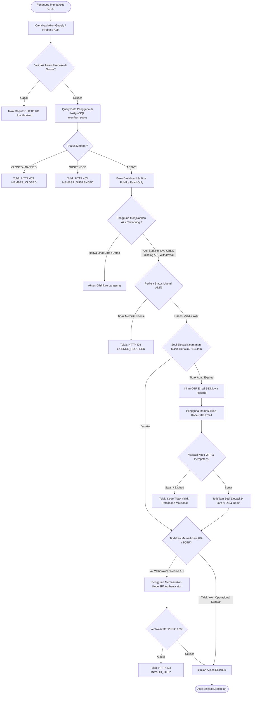
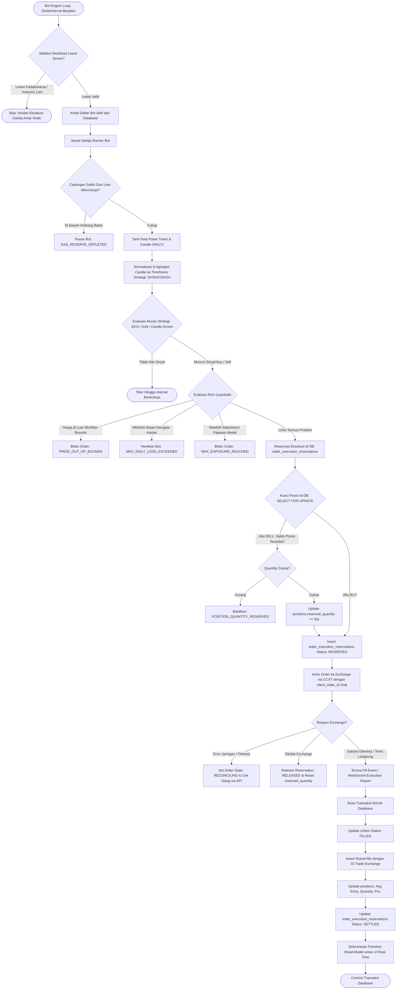
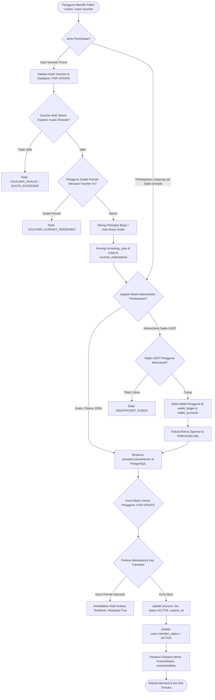

# Master Flowchart Sistem - GAIN NiagaKoin v4.0.0

Dokumen ini memetakan seluruh alur logika sistem GAIN NiagaKoin v4.0.0 secara komprehensif. Diagram disajikan menggunakan sintaks Mermaid standar yang dapat dirender otomatis oleh GitHub/Markdown viewer, disertai narasi logika langkah demi langkah, kondisi percabangan (*decision branching*), dan penanganan galat (*exception handling*).

---

## Daftar Isi
1. [Flowchart 1: Autentikasi & Model Otorisasi Arsitektur 25](#flowchart-1-autentikasi--model-otorisasi-arsitektur-25)
2. [Flowchart 2: Alur Siklus Hidup Bot Trading & Eksekusi Perdagangan](#flowchart-2-alur-siklus-hidup-bot-trading--eksekusi-perdagangan)
3. [Flowchart 3: Siklus Kustodi On-Chain Native BSC USDT (Deposit & Withdrawal)](#flowchart-3-siklus-kustodi-on-chain-native-bsc-usdt-deposit--withdrawal)
4. [Flowchart 4: Alur Pemulihan Kegagalan (Crash Recovery) & Rekonsiliasi Fail-Closed](#flowchart-4-alur-pemulihan-kegagalan-crash-recovery--rekonsiliasi-fail-closed)
5. [Flowchart 5: Sistem Aktivasi Lisensi & Penukaran Voucher Idempoten](#flowchart-5-sistem-aktivasi-lisensi--penukaran-voucher-idempoten)

---

## Flowchart 1: Autentikasi & Model Otorisasi Arsitektur 25

Model Arsitektur 25 memisahkan hak akses login dasar dengan otorisasi transaksi berisiko tinggi. Pengguna gratis dapat mengakses dashboard, namun fitur kritis membutuhkan elevasi keamanan (*24-hour Session Elevation*) dan verifikasi 2FA TOTP.



### Penjelasan Logika Flowchart 1:
1. **Verifikasi Identitas**: Token ID Firebase diverifikasi melalui `firebase-admin` pada middleware `requireFirebaseIdentity`.
2. **Lifecycle Anggota**: Status pengguna di cek di PostgreSQL (`users.member_status`). Bila berstatus `SUSPENDED` atau `CLOSED`, akses ditolak tanpa kompromi.
3. **Pemisahan Dashboard vs Lisensi**: Pengguna tanpa lisensi (`license_status = 'none'`) tetap dapat masuk ke dashboard untuk melihat portofolio dan backtesting, namun tidak dapat menjalankan live-trading.
4. **Sesi Keamanan Elevasi (24 Jam)**: Tindakan seperti konfigurasi bot atau live-order memerlukan sesi elevasi. Jika sesi telah kedaluwarsa, kode OTP 6-digit dikirimkan melalui Resend. Sesi disimpan di PostgreSQL (`auth_session_elevations`) agar bertahan meskipun Redis mengalami restart.
5. **Faktor Transaksi Kritis (TOTP)**: Penarikan dana dan rotasi kunci API exchange mewajibkan faktor kedua berupa TOTP Authenticator (RFC 6238).

---

## Flowchart 2: Alur Siklus Hidup Bot Trading & Eksekusi Perdagangan

Alur ini mengendalikan loop evaluasi kondisi pasar, pembatasan risiko (*risk guardrails*), pencegahan duplikasi eksekusi (*execution reservation*), dan penyelesaian buku besar (*settlement*).



### Penjelasan Logika Flowchart 2:
1. **Heartbeat Lease**: Menjamin hanya satu node instance yang memproses runner bot tertentu untuk mencegah *split-brain execution*.
2. **Proteksi Gas & Risiko**: Bot secara berkala memeriksa saldo gas operasional. Sebelum order dibuat, sistem mengevaluasi ambang batas harga (*price bounds*), alokasi modal maksimum (*max committed capital*), dan batas kerugian harian (*max daily loss*).
3. **Pola Reservasi Eksekusi (Anti-Double Selling)**: 
   - Untuk order jual (*SELL*), baris posisi dikunci menggunakan `SELECT ... FOR UPDATE`.
   - Kolom `reserved_quantity` dinaikkan seketika. Jika order lain mencoba menjual koin yang sama pada saat bersamaan, permintaan kedua akan diblokir karena kuantitas yang tersedia tidak mencukupi.
4. **Idempotent Settlement**: Sinyal fill diproses secara atomik di dalam satu transaksi PostgreSQL: mencatat rekod pengisian (*fill*), memperbarui posisi (*durable position*), dan mengubah status reservasi menjadi `SETTLED`.

---

## Flowchart 3: Siklus Kustodi On-Chain Native BSC USDT (Deposit & Withdrawal)

Siklus ini mengatur pengelolaan dana on-chain pada BNB Smart Chain (BEP-20 USDT) secara non-kustodial terpusat dengan segregasi dompet operasional, hot wallet, dan cold storage.

```mermaid
flowchart TD
    subgraph Alur_Deposit_Otomatis [Alur Deposit Otomatis]
        UserDep[Pengguna Membuka Halaman Dompet] --> GenAddr[Sistem Menurunkan Alamat Unik via BIP44 HD: m/44'/60'/0'/0/index]
        GenAddr --> ShowQR[Tampilkan Alamat & QR Code BSC kepada Pengguna]
        
        ScannerWorker([Background Worker: scanNativeBscDeposits]) --> PollRPC[Query eth_getLogs dari BSC RPC untuk Kontrak USDT]
        PollRPC --> ParseLogs[Ekstraksi Event Transfer: from, to, value, txHash]
        ParseLogs --> CheckRecipient{Apakah Alamat Penerima Terdaftar di DB?}
        
        CheckRecipient -- Bukan Alamat Pengguna --> IgnoreLog[Abaikan Log Event]
        CheckRecipient -- Cocok dengan Alamat Pengguna --> CheckConfirmations{Konfirmasi Blok >= BSC_MIN_CONFIRMATIONS?}
        
        CheckConfirmations -- Belum Cukup --> WaitBlock[Tunggu Blok Tambahan Terkonfirmasi]
        CheckConfirmations -- Cukup --> CheckTxReplay{Cek Duplikasi: Apakah tx_hash Sudah Diklaim di DB?}
        
        CheckTxReplay -- Sudah Pernah Diproses --> DropDuplicate[Abaikan: DEPOSIT_TX_ALREADY_CLAIMED]
        CheckTxReplay -- Belum Pernah --> AtomicDepositTx[Buka Transaksi Database PostgreSQL]
        
        AtomicDepositTx --> RecordDeposit[Insert ke deposits Status: COMPLETED]
        RecordDeposit --> CreditLedger[Insert ke wallet_ledger & Tambah wallet_accounts.balance]
        CreditLedger --> MirrorDepFS[Sinkronisasi Saldo ke Firestore Mirror]
        MirrorDepFS --> CommitDeposit([Deposit Berhasil Dikreditkan])
    end

    subgraph Alur_Penarikan_Dana_Withdrawal [Alur Penarikan Dana / Withdrawal]
        StartWD[Pengguna Mengajukan Request Penarikan] --> ValidateWDFactors{Validasi TOTP 2FA & Sesi Elevasi?}
        ValidateWDFactors -- Tidak Valid --> RejectWDFactor[Tolak Penarikan: 403 Forbidden]
        ValidateWDFactors -- Valid --> CheckWDPolicy{Evaluasi Kebijakan Finansial POJK / Risk Limit}

        CheckWDPolicy -- Melebihi Limit Harian / Di Bawah Min --> RejectWDLimit[Tolak: WITHDRAWAL_LIMIT_EXCEEDED]
        CheckWDPolicy -- Alamat Tujuan Baru (< Cooldown) --> RejectWDCooldown[Tolak: ADDRESS_COOLDOWN_ACTIVE]
        CheckWDPolicy -- Lolos Verifikasi --> LockUserBal[Lock Saldo Pengguna & Potong Saldo Tersedia]

        LockUserBal --> InsertWDPending[Insert withdrawals Status: PENDING_APPROVAL]
        InsertWDPending --> DualApproval{Memerlukan Persetujuan Ganda: 2 Approver?}
        
        DualApproval -- Menunggu Approval --> HoldQueue[Antrean Penarikan Tertahan]
        DualApproval -- Telah Diapprove 2 Pejabat Finansial --> ProcessorWorker([Worker: processNativeWithdrawal])

        ProcessorWorker --> ClaimWDLease[Klaim Baris Penarikan dengan Processor Lease]
        ClaimWDLease --> CheckHotGas{Saldo BNB Hot Wallet Cukup untuk Gas Fee?}
        CheckHotGas -- Kurang --> AutoRefillGas[Eksekusi Gas Auto-Refill dari Kas Operasional]
        CheckHotGas -- Cukup --> SignRawTx[Buka Kunci Enkripsi Hot Wallet & Sign Transaksi secp256k1]

        AutoRefillGas --> SignRawTx
        SignRawTx --> BroadcastTx[Kirim Raw Transaction via eth_sendRawTransaction]
        BroadcastTx --> WaitForReceipt{Tunggu Konfirmasi Receipt On-Chain}

        WaitForReceipt -- Gagal / Revert On-Chain --> FailWD[Rollback: Kembalikan Saldo Pengguna di Ledger]
        WaitForReceipt -- Sukses Terkonfirmasi --> SettleWD[Update withdrawals Status: COMPLETED & Audit Event]
        SettleWD --> EndWD([Penarikan Selesai])
    end
```



### Penjelasan Logika Flowchart 3:
1. **Derivasi Alamat HD BIP44**: Alamat deposit pengguna diturunkan secara deterministik dari seed master yang dienkripsi dengan AES-256-GCM (`m/44'/60'/0'/0/${index}`). Kunci privat tidak pernah disimpan dalam format teks biasa (*plaintext*).
2. **Scanner Anti-Replay**: Pemindai log memeriksa nilai transaksi dan mencocokkannya ke basis data. Konstrain integritas `UNIQUE(network, tx_hash)` mencegah serangan *credit replay*.
3. **Pemisahan Dana (*Funds Segregation*)**: Dana operasional perusahaan dan dana konsumen dipisahkan secara fisik di rekening dan alamat blockchain terpisah.
4. **Governance Penarikan**: Penarikan di atas batas ambang memerlukan persetujuan ganda (*dual-officer approval*). Pekerja pemroses menandatangani transaksi on-chain secara terisolasi dengan sewa (*lease*) eksklusif untuk mencegah eksekusi ganda jika worker di-restart.

---

## Flowchart 4: Alur Pemulihan Kegagalan (Crash Recovery) & Rekonsiliasi Fail-Closed

Sistem GAIN mengadopsi prinsip **Fail-Closed by Default**. Saat server atau runtime dimulai ulang (*restart*), seluruh bot tidak langsung dijalankan secara liar tanpa pengawasan, melainkan dipertahankan dalam status aman hingga diverifikasi.

```mermaid
flowchart TD
    Boot([Server Node.js Booting / Restart]) --> ReadEnv[Baca Konfigurasi Lingkungan: .env]
    ReadEnv --> CheckAutoResume{BOT_STARTUP_AUTO_RESUME == true && Konfirmasi Valid?}

    CheckAutoResume -- Tidak (Default Fail-Closed) --> SafeState[Tandai Semua Bot Aktif Sebelumnya ke Status PAUSED]
    SafeState --> EmitAuditBoot[Catat Audit Event: BOT_STARTUP_SAFE_PAUSE_APPLIED]
    EmitAuditBoot --> NotifyUser[Kirim Notifikasi ke Operator: Manual Resume Diperlukan]
    NotifyUser --> ReadyServer([Server Siap Menerima Request])

    CheckAutoResume -- Ya (Opt-In Eksplisit) --> QueryActiveDB[Ambil Runner Bot yang Berstatus RUNNING dari DB]
    QueryActiveDB --> LoopRecover[Iterasi Setiap Runner Bot untuk Rekonsiliasi]

    LoopRecover --> CheckHangingOrders{Terdapat Order Menggantung? Status SUBMITTING / RECONCILING}
    
    CheckHangingOrders -- Tidak Ada Order Tertunda --> SyncPositions[Sinkronisasi Posisi Lokal vs Exchange Balances]
    CheckHangingOrders -- Ada Order Tertunda --> QueryExchangeOrder[Query Status Pesanan ke Exchange via CCXT menggunakan client_order_id]

    QueryExchangeOrder --> ExchangeOrderStatus{Status Pesanan di Exchange?}
    ExchangeOrderStatus -- Order Tidak Ditemukan / Canceled --> CancelLocal[Tandai Order Lokal: CANCELLED & Lepas Reservasi Saldo]
    ExchangeOrderStatus -- Order Terisi (Filled) --> ReplayFill[Eksekusi Finalize Order & Settle Posisi di DB]
    ExchangeOrderStatus -- Masih Terbuka (Open) --> KeepOpen[Pertahankan State SUBMITTED & Lanjutkan Monitoring]

    CancelLocal --> SyncPositions
    ReplayFill --> SyncPositions
    KeepOpen --> SyncPositions

    SyncPositions --> CheckPositionDrift{Apakah Terdeteksi Selisih Posisi (Drift)?}
    CheckPositionDrift -- Selisih Melebihi Toleransi --> QuarantineBot[Karantina Bot: POSITION_DRIFT_ALERT & Pause Bot]
    CheckPositionDrift -- Posisi Sinkron --> ResumeLoop[Aktifkan Heartbeat Loop & Mulai Runner Bot]

    QuarantineBot --> NextBot{Masih Ada Bot Berikutnya?}
    ResumeLoop --> NextBot

    NextBot -- Ya --> LoopRecover
    NextBot -- Selesai --> ReadyServer
```

### Penjelasan Logika Flowchart 4:
1. **Prinsip Fail-Closed**: Ketika terjadi *power failure* atau *container restart*, bot tidak otomatis mengeksekusi order baru sampai integritas posisi divalidasi.
2. **Penyelesaian Order Menggantung**: Pesanan yang berstatus `SUBMITTING` atau `RECONCILING` diselidiki langsung ke exchange menggunakan `client_order_id` yang bersifat deterministik dan unik.
3. **Deteksi Drift Posisi**: Jika jumlah aset pada akun exchange berbeda dengan catatan di `positions` PostgreSQL, bot akan dikarantina (*PAUSED*) untuk mencegah kesalahan perhitungan averaging berikutnya.

---

## Flowchart 5: Sistem Aktivasi Lisensi & Penukaran Voucher Idempoten

Alur ini mengelola aktivasi tier lisensi bot (Starter, Pro, Elite) dan penukaran voucher promosi dengan jaminan bebas race-condition.



### Penjelasan Logika Flowchart 5:
1. **Penguncian Baris Voucher**: Pengecekan kuota voucher menggunakan `SELECT ... FOR UPDATE` untuk mencegah eksploitasi penggunaan ganda saat ribuan pengguna menukarkan kode voucher yang sama secara serentak (*flash claim*).
2. **Idempotensi Transaksi Atomik**: Fungsi `activateLicenseAtomic` mencatat kunci unik idempotensi. Pengiriman ulang formulir akibat gangguan jaringan tidak akan menagih biaya saldo dua kali.
3. **Pembaharuan Hak Slot Bot**: Begitu lisensi aktif, batas maksimum bot aktif (`maxActiveBots`) langsung dimutakhirkan secara otomatis.
